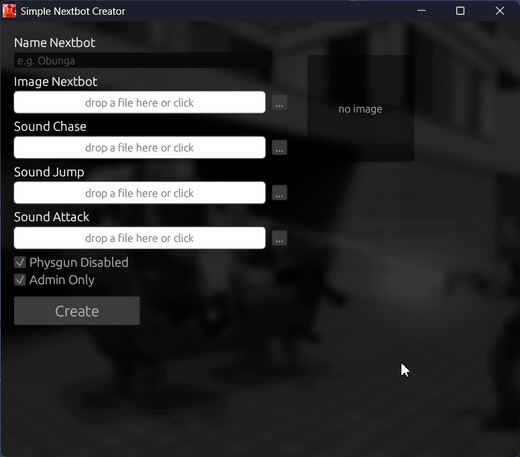
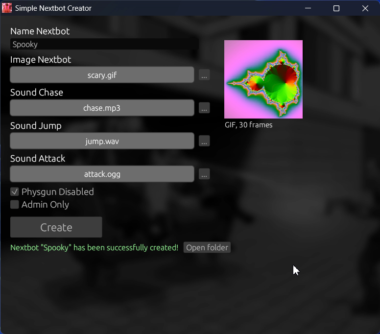

# Nextbot Creator

Make your own Garry's Mod nextbot in a few clicks: a name, a picture, three sounds. Now with **animated GIF** support.

A Rust (egui) rewrite of [Simple Nextbot Creator](https://gamebanana.com/tools/18165) by IRKAR.

<p align="center"></p>

## Download

Grab `NextbotCreator.exe` from [Releases](../../releases). Single file, Windows, nothing to install.

## How to use

1. Type the nextbot's name (latin letters are used for the file names).
2. Drop (or click and pick) an image: PNG, JPG, BMP or **GIF**.
3. Drop the chase, jump and attack sounds: MP3, WAV or OGG.
4. Tick **Physgun Disabled** / **Admin Only** if you want.
5. Press **Create**. The addon folder appears next to the exe; put it in `garrysmod/addons`.

The bot shows up in the spawn menu under **NPCs > Nextbots**.

## Screenshot

<p align="center"></p>

## GIF support

GMod cannot load `.gif` materials, so every frame is saved as `materials/<name>/frames/frameN.png` and the generated Lua plays them back with the GIF's own frame timing.

## Fixes compared to the original

- **Physgun Disabled** and **Admin Only** really work now (the original wrote `True`/`False`, which Lua reads as `nil`).
- Jump and attack sounds keep their own file type (before, they took the chase sound's extension and went silent when formats were mixed).
- Quotes in the bot name no longer break the Lua file.

## Build

```
cargo build --release
cargo test
```

## License

MIT, see [LICENSE](LICENSE).
